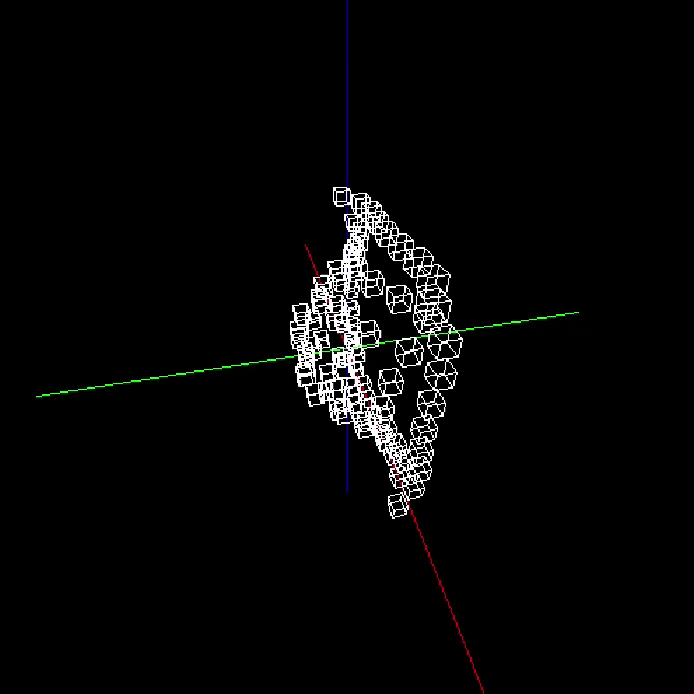

# 3D Wireframe Cube Renderer

*A small learning project in Java: a wireframe cube renderer with a movable camera.*

---

### Features

- **World-to-screen projection**: converts 3D world-space coordinates to 2D screen-space
- **Custom vector math**: hand-rolled `Vector` class and vector operations, no external libraries
- **Custom wireframe rendering**: own drawing routines for edges and vertices

## Controls

| Key | Action |
|:---:|--------|
| <kbd>W</kbd> | Move camera up |
| <kbd>S</kbd> | Move camera down |
| <kbd>A</kbd> | Rotate camera around the Z-axis (left) |
| <kbd>D</kbd> | Rotate camera around the Z-axis (right) |